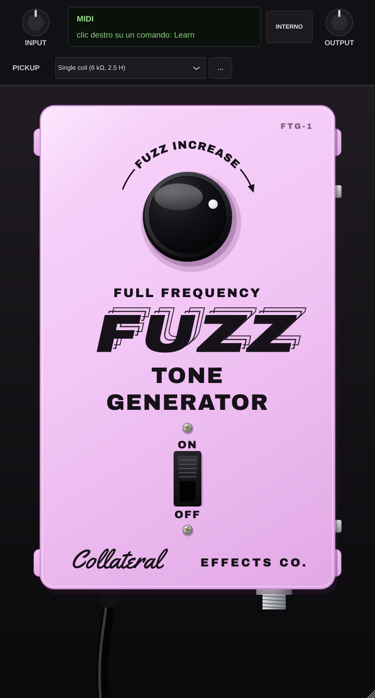

# Collateral Effects FTG-1 — emulazione fisica del Walco Fuzz Tone Generator (VST3 / AU / Standalone)

Plugin in C++17 con JUCE 8. Riferimento: il Walco "Full Frequency Fuzz Tone Generator" (Giappone,
fine anni '60), circuito identico al Kent EA-3 Fuzz Tone Bender. Due NPN al silicio 2SC828, un solo
comando (FUZZ INCREASE) e l'interruttore a slitta ON/OFF.



## Comandi

| Comando | CC predefinito |
|---|---|
| FUZZ INCREASE (50k lineare) | 20 |
| Interruttore ON/OFF | 64 (pedale sustain: commuta alla pressione) |
| INPUT / OUTPUT (trim di servizio, barra superiore) | — |

**FUZZ INCREASE** non è un "gain": il potenziometro miscela due uscite. Tutto a sinistra (lug 1)
si sente il primo stadio (Q2), già saturo con segnali forti ma pieno e scuro; girando in senso
orario entra il ramo di Q1, che è sottile, ronzante, a "spilli". A fondo corsa resta solo quello.

Livelli reali: 0 dBFS in ingresso = 1 V di picco, e l'uscita non è compensata. A FUZZ INCREASE
alto il pedale esce più o meno al livello della chitarra (Steve Albini, che ne aveva uno, si
lamentava proprio del calo di volume); verso sinistra esce invece più forte (fino a +14 dB):
usa OUTPUT per bilanciare.

**MIDI Learn**: clic destro su un comando → *MIDI Learn* → muovi un controllo della KeyLab.
La mappatura è salvata nel progetto. Per l'interruttore imposta il pulsante della KeyLab in
modalità *Gate/Momentary* in Arturia MIDI Control Center.

Il pedale è mono: il plugin prende la chitarra da qualunque ingresso arrivi e copia l'uscita su
tutti i canali. Con l'interruttore su OFF il segnale passa invariato e il circuito non consuma CPU.

## Pick-up (barra superiore)

L'ingresso di questo pedale è una massa virtuale (base di Q2 retroazionata, attraverso 50 nF): carica
il pick-up moltissimo, per cui resistenza e induttanza della bobina fanno parte del circuito e
tagliano gli acuti prima del fuzz. Scegli il pick-up che stai suonando (Ideale, Single coil, P-90,
Humbucker, Personalizzato) oppure **Linea / synth** (300 Ω) per sorgenti a bassa impedenza come
sintetizzatori, drum machine o tracce già registrate in linea. Con il pulsante "…" salvi i valori con
il nome della chitarra ("Le mie chitarre"); al primo avvio vengono riprese quelle salvate in FYN-2.

Come in FYN-2, con un pick-up selezionato il plugin ricostruisce il segnale del pick-up prima del
circuito (la scheda audio registra a 1 MΩ, il pedale no); con "Ideale" e "Linea" la correzione è spenta.

## Interno (pulsante INTERNO)

- **BATT / DC** e **CARICA** (4,5–9,6 V): l'originale andava a batteria. La tensione cambia
  soprattutto la dinamica di Q2 (1° stadio).
- **hFE Q2 / hFE Q1** (60–560): guadagno dei due 2SC828 (classi Q 130–260, R 180–360, S 260–520).
  Q2 conta molto: con hFE basso il collettore sale (6 V a hFE 60) e il primo stadio diventa più
  pulito e simmetrico; con hFE alto scende verso 2 V e satura prima. Q1 è così "affamato" che
  il suo hFE cambia poco. "VALORI ORIGINALI" riporta 9 V e hFE 250.

## Il circuito

Netlist ricostruita dal layout stripboard di tagboardeffects (mirosol), con i valori dell'originale
al posto di quelli adattati dal layout:

| Layout | Originale (usato nel plugin) |
|---|---|
| 470 kΩ (Q2 collettore→base) | 500 kΩ |
| 47 nF (ingresso e verso lug 1) | 50 nF |
| 1 MΩ pull-down in ingresso | assente (aggiunta del layout) |
| 1N5817 protezione polarità | assente (aggiunta del layout) |
| 470 pF ramo fuzz | 470 pF (correzione FSB dello "47p" dello schema) |
| 2N5088 / 2N3904 | 2SC828 |

```
ingresso ─50n─┬─ B Q2 ── (E a massa)      C Q2 ─4k7─ +9V
              ├─500k── C Q2               C Q2 ─50n── lug 1 ─┐
              └─10n─── C Q2               C Q2 ─100n─ B Q1   │ FUZZ INCREASE 50k lin
B Q1 ─330k─ C Q1 ─820k─ +9V                                  │ cursore = uscita
C Q1 ─470p─18k─┬─ lug 3 ─────────────────────────────────────┘
               └─12k─ massa
```

Punto di lavoro calcolato (9 V, hFE 250): Q2 collettore 3,1 V (1,25 mA), Q1 collettore 0,55 V
(10 µA, sul filo della saturazione).

## Il modello

- Analisi nodale a 10 nodi con tutti i componenti, il pick-up (R, L, capacità propria, pot della
  chitarra), il cavo e il carico dell'ampli (1 MΩ); condensatori e induttanza con la regola dei trapezi.
- Q1 e Q2 con Ebers-Moll completo (giunzioni B-E e B-C, β diretto e inverso, Cbe e Cbc),
  risolti con Newton-Raphson sulle 4 tensioni di giunzione (metodo "K"/DK), con predittore.
- Punto di lavoro iniziale con Eulero implicito a passo largo (meno di 1 ms).
- Il circuito gira sempre a 350–390 kHz: oversampling 8× a 44.1/48 kHz, 4× a 88.2/96 kHz,
  2× a 176.4/192 kHz. Latenza 6 campioni. Circa il 12% di un core a 48 kHz sul server di
  compilazione Linux (meno su Apple Silicon).

**Limiti noti**: il layout è la sola fonte (non c'è uno schema di fabbrica né un esemplare misurato);
l'hFE dei 2SC828 originali non è noto e si usa un valore centrale; la rottura inversa della giunzione
B-E (circa 5 V) non è modellata; il verso del pot (orario = più fuzz) segue la scritta
"FUZZ INCREASE" con la freccia verso destra.

## Scaricare la versione per Mac (Apple Silicon e Intel)

Ogni modifica su `main` viene compilata da GitHub Actions su macOS (universal binary).

1. **Actions → Build macOS** → ultima esecuzione riuscita → scarica l'artefatto **FTG1-macOS**.
   Con un tag `v1.0.0` la build compare anche in **Releases**.
2. Estrai lo zip (contiene `FTG1-macOS.zip`: estrai anche quello).
3. Terminale: `xattr -dr com.apple.quarantine ` e trascina la cartella `FTG-1`, poi doppio clic su
   **Installa FTG-1.command** (password di amministratore).
4. Riavvia la DAW (Logic: *Plug-in Manager → Reimposta e riscansiona* se non compare).

## Usare la KeyLab

- **Ableton Live**: plugin sulla traccia audio della chitarra; una traccia MIDI con ingresso KeyLab
  e *MIDI To* → la traccia della chitarra → "FTG-1". Oppure la mappatura MIDI di Live (Cmd+M).
- **Logic Pro**: l'AU è un normale Audio FX e non riceve CC: usa l'assegnazione controller di Logic
  (Cmd+K, muovi il comando nel plugin e poi la manopola). MIDI Learn interno e CC valgono per VST3
  e Standalone.

## Compilazione

CMake ≥ 3.22; JUCE 8.0.4 viene scaricato da solo (oppure `-DJUCE_DIR=/percorso/JUCE`).

```
cmake -B build -G Xcode            # macOS
cmake --build build --config Release
```

Test: `circuit_test` (punto di lavoro, livelli, CPU), `click_test` (niente salti del risolutore con
pot, pick-up, batteria e hFE mossi suonando) e, con `-DFTG_BUILD_PROCESSOR_TEST=ON`, `processor_test`
(blocchi della DAW, CC 20/64, MIDI Learn, bypass, salvataggio dello stato). Girano tutti su GitHub.
`-DFTG_BUILD_SNAPSHOT=ON` compila lo strumento che rigenera `resources/icon.png` e lo screenshot.

## Grafica e caratteri

Interfaccia ispirata al pedale originale (scatola smaltata rosa-lilla, manopola nera con punto bianco,
interruttore a slitta, cavo d'ingresso), con lettering e marchio propri: il logo Walco non è riprodotto.
Caratteri: Archivo Black (SIL OFL) e Yellowtail (Apache 2.0), licenze in `resources/fonts/`.
